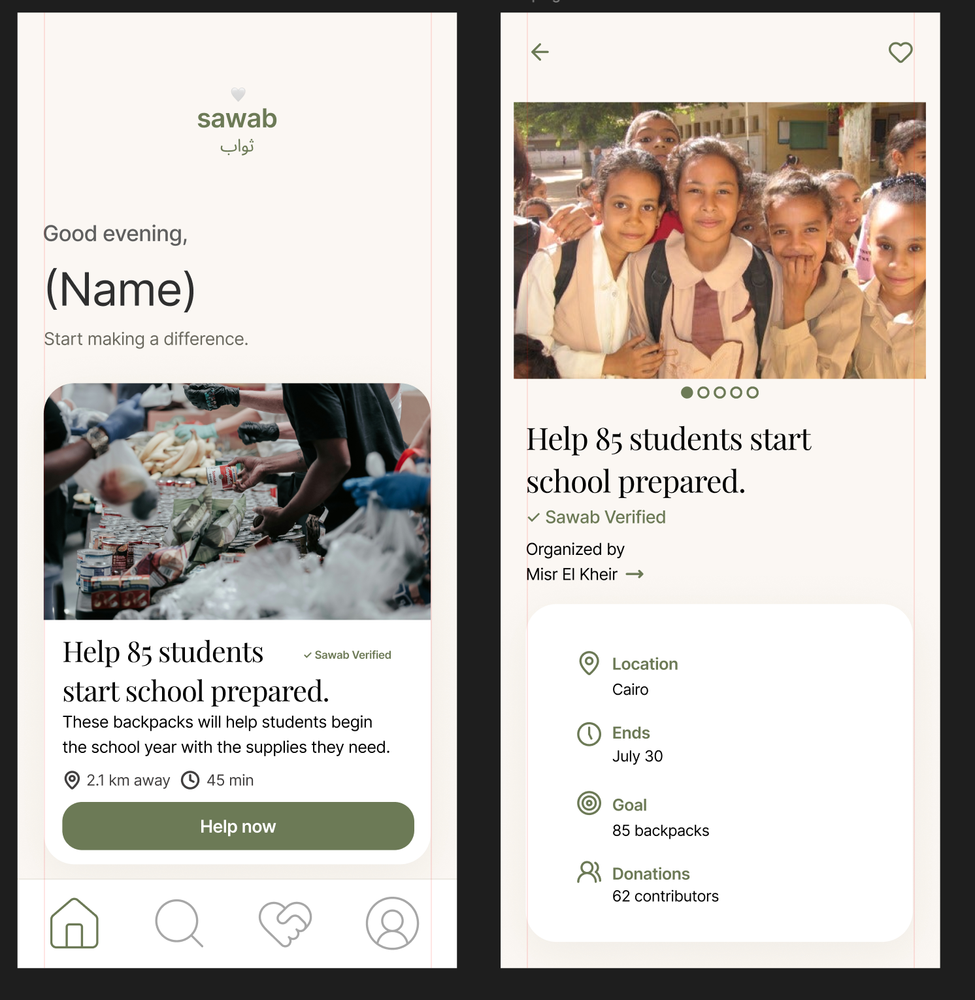

# Sawab · ثواب

A SwiftUI charity app prototype connecting people with opportunities to help underserved communities in Egypt. Warm cream backgrounds, muted olive, peach accents, and editorial serif headings give the interface a welcoming identity.



## Development status

Sawab is a local SwiftUI MVP and portfolio prototype. All opportunities, organizations, verification indicators, dates, and participation counts are fictional demo data. It does not process donations or payments, send messages, or provide authentication.

The iOS app builds successfully and all four model tests pass. Simulator readiness failures prevented the latest visual and interaction walkthrough; see the [validation notes](docs/README.md). Final app-icon artwork and a full accessibility review are still pending.

## Run

1. Clone or download this repository, then open `Sawab.xcodeproj` in Xcode with an SDK supporting the project's iOS 26.5 deployment target.
2. Select the `Sawab` scheme and an iPhone simulator running iOS 26.5 or later.
3. Build and run with Command-R. For a physical device, configure your own signing team.

Technologies: Swift, SwiftUI, Observation, UserDefaults, and Xcode asset catalogs. No API keys, third-party packages, or backend setup are required.

## Architecture

```text
Sawab/
  App/          App entry point and RootView composition
  Models/       Opportunity, sample records, and FavoritesStore
  Views/        Home, Explore, Saved, Profile, OpportunityDetail
  Components/   BrandMark, OpportunityCard, OpportunityPhoto, SawabTabBar
  Theme/        Shared palette and typography
  Assets.xcassets/
docs/           Design reference and validation checklist
Tests/          Swift Testing model tests
Package.swift   Host-side model test harness
```

Each screen lives in its own Swift file. `RootView` owns the selected tab and an observable `FavoritesStore` containing saved opportunity IDs. Bindings let Home, Explore, Saved, and Detail share that single source of truth. Explore owns its local search and filter state; Detail owns its demo alert state. Views use value-based navigation with `Opportunity`, which is `Identifiable` and `Hashable`.

The custom tab bar is a presentation component with a selection binding. RootView retains responsibility for choosing the active navigation stack. The tab bar occupies a separate layout row below that stack so scrollable cards cannot be covered by it. Switching tabs recreates the selected screen; independent navigation histories and search state are not retained across tab changes.

Shared components and `SawabTheme` keep the design consistent without adding a view-model layer to this small, synchronous prototype. `FavoritesStore` writes stable IDs to UserDefaults on every change and restores them at launch. Sample records are isolated in `SampleOpportunities.swift`; search logic stays in the model for independent verification.

## Features and current limits

- Home feed and opportunity detail navigation.
- Four fictional opportunities across Cairo, Giza, Alexandria, and Aswan. Explore searches titles, cities, descriptions, organizers, and categories, combined with Give items, Give time, and Share skills filters.
- Save and unsave opportunities; Saved includes an empty state.
- Profile concept screen and a demo-only help alert.
- Favorites persist locally across app launches using UserDefaults. Removing a saved item is persisted too; there is no cloud sync.
- Organizations, verification labels, needs, dates, distances, and counts are sample content. No donations, messages, or account creation occur.
- Typography uses the built-in system serif, paired with a neutral system sans serif. Photography remains illustrative placeholder content, so this is a visual interpretation of the supplied reference.
- The AppIcon asset set is present for builds but still needs final 1024 × 1024 artwork before release.

## Validation

Build with Command-B. See [the manual checklist](docs/README.md) for interaction checks. Run `swift test` from the repository root to execute the Swift Testing model suite on macOS 14 or later. The lightweight Package.swift compiles the same model files used by the iOS app; it adds no runtime dependencies. Tests cover persistence round trips, removals, malformed storage, sample identity, and combined search/filter behavior. A full accessibility audit remains future work.

## Repository notes

The asset catalog contains the school-supplies illustration, AccentColor, and an AppIcon placeholder. Other opportunities use local vector-style illustrations. No unused Swift screen files were found. Design references stay in `docs/` and are excluded from app resources.

Xcode user state and generated build products are excluded by `.gitignore`. Keep the project file, asset catalogs, Package.swift, and tests under version control. `Package.resolved` should also be committed if package dependencies are introduced.

Design concept: Dalia Mahmoud.
