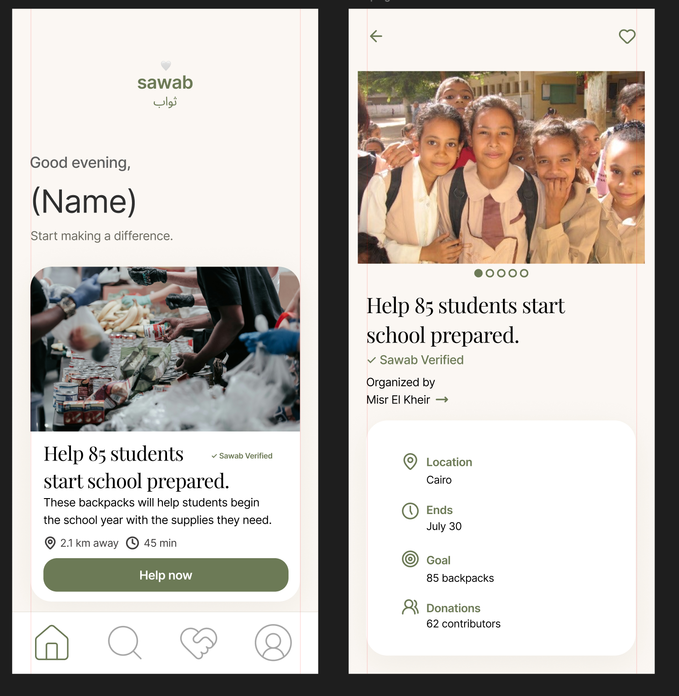

# Sawab design and validation notes

See [the project README](../README.md) for setup, architecture, and prototype limitations.

## Design direction

The supplied reference covers Home and Opportunity Detail. Preserve its generous margins, prominent imagery, cream canvas, olive controls, serif opportunity headings, and rounded cards. Explore, Saved, and Profile extend that same palette and typography. Peach is used sparingly for category labels and welcoming empty-state details.

Colors and fonts live in `Sawab/Theme/SawabTheme.swift`; reusable card and navigation styling live in `Sawab/Components/`.

## Manual interaction checklist

- Launch the app and confirm Home is selected.
- Open each Home opportunity and return using Back.
- Save an opportunity in Detail, open Saved, and confirm it appears.
- Quit and relaunch the app; confirm saved opportunities remain.
- Remove it from Detail and confirm Saved returns to its empty state, including after relaunch.
- Search Explore for Cairo, Giza, and an unmatched term.
- Combine search with each category filter and verify matching results.
- Open Detail from both Explore and Saved.
- Tap the help action and dismiss the demo alert.
- Switch among all four tabs; confirm the Explore icon remains visible when selected.
- Check scrolling and bottom-bar clearance on small and large iPhones.

## Before release

Add final app-icon artwork, authorized photography, and real service integrations as appropriate. Review Dynamic Type, VoiceOver, contrast, localization, and interaction behavior on devices before presenting the app as production-ready.

## Validation results — November 12, 2026

- Xcode app builds passed after layout/persistence, sample data/search, detail styling, and final cleanup.
- Four Swift Testing tests passed in two suites: persistence restore/removal, malformed storage, stable sample IDs/categories, and search/category combinations.
- Git diff whitespace checks passed.
- iPhone 17 and iPhone 18 Pro simulator sessions both timed out during readiness, before installation and launch. On-device layout, tapping, and restart walkthroughs remain unverified.
- Run `swift test` from the root for the model suite. These tests use isolated UserDefaults suites and clean them up; they do not change app favorites.
